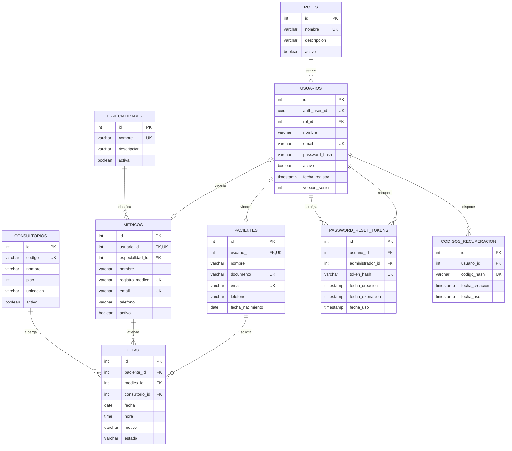

# API Hospital — Base de datos PostgreSQL

**Proyecto:** API Hospital Segura  
**Contexto:** Integración Frontend, Backend y Base de Datos  
**Motor:** PostgreSQL  
**Plataforma:** Supabase  
**Esquema:** `public`

---

## 1. Descripción

La base de datos de API Hospital permite almacenar y gestionar la información de usuarios, roles, médicos, pacientes, especialidades, consultorios y citas médicas.

También incorpora estructuras destinadas a la seguridad de las cuentas, incluyendo recuperación administrativa de contraseñas, códigos de respaldo y control de versiones de sesión.

La aplicación utiliza una arquitectura cliente-servidor desacoplada:

**React + Vite → API REST Node.js/Express → PostgreSQL (Supabase)**

El frontend no se conecta directamente a PostgreSQL. Las operaciones se realizan mediante el backend, que implementa autenticación JWT, autorización RBAC y controles de acceso a recursos BOLA/IDOR.

## 2. Estructura de archivos

```text
database/
│
├── 01_esquema_hospital.sql
├── 02_seed_roles.sql
├── 03_seed_catalogos_demo_OPCIONAL.sql
├── 04_seguridad_rls.sql
├── 05_verificacion_lectura.sql
├── 06_indices_adicionales_OPCIONAL.sql
│
├── historico/
│   ├── 01_esquema_hospital.sql
│   ├── 02_roles_seguridad.sql
│   ├── 03_verificacion.sql
│   ├── 11_3_version_sesion.sql
│   ├── 11_4_2_codigos_recuperacion.sql
│   └── 11_4_password_reset_tokens.sql
│
└── README.md
```

La carpeta `historico/` conserva los scripts originales de los laboratorios anteriores para facilitar la trazabilidad del desarrollo. Estos archivos no forman parte de la instalación consolidada.

## 3. Modelo de datos

El esquema hospitalario contiene nueve tablas principales.

| Tabla | Función |
|---|---|
| `roles` | Define los roles del sistema. |
| `usuarios` | Almacena las cuentas y credenciales de acceso. |
| `especialidades` | Registra las especialidades médicas. |
| `medicos` | Almacena las fichas profesionales y su vinculación con usuarios. |
| `pacientes` | Registra los datos personales y su vinculación con usuarios. |
| `consultorios` | Administra los espacios de atención hospitalaria. |
| `citas` | Gestiona la programación y los estados de las citas. |
| `password_reset_tokens` | Almacena tokens temporales para recuperación administrativa de contraseñas. |
| `codigos_recuperacion` | Almacena los hashes de los códigos de recuperación de un solo uso. |

### Relaciones principales

- `usuarios.rol_id` → `roles.id`
- `medicos.usuario_id` → `usuarios.id`
- `medicos.especialidad_id` → `especialidades.id`
- `pacientes.usuario_id` → `usuarios.id`
- `citas.paciente_id` → `pacientes.id`
- `citas.medico_id` → `medicos.id`
- `citas.consultorio_id` → `consultorios.id`
- `password_reset_tokens.usuario_id` → `usuarios.id`
- `password_reset_tokens.administrador_id` → `usuarios.id`
- `codigos_recuperacion.usuario_id` → `usuarios.id`

Estas relaciones permiten mantener la integridad referencial y asociar las operaciones hospitalarias con los registros correspondientes.

## 4. Descripción de los scripts SQL

### 4.1. `01_esquema_hospital.sql`

Archivo principal para crear el modelo de datos en una instalación nueva.

Contiene la estructura consolidada de las nueve tablas, sus relaciones, restricciones e índices principales.

Incluye los elementos incorporados durante los laboratorios de autenticación y recuperación de contraseñas, como `version_sesion`, `password_reset_tokens` y `codigos_recuperacion`.

**No debe ejecutarse nuevamente sobre la base de datos existente sin verificar previamente su compatibilidad.**

### 4.2. `02_seed_roles.sql`

Inserta los roles básicos de autorización:

- `administrador`: gestión administrativa del sistema.
- `medico`: consulta y atención de citas autorizadas.
- `paciente`: consulta y gestión de sus propias citas, según los permisos del backend.

La existencia de estos registros es necesaria para asociar las cuentas con los roles correspondientes.

### 4.3. `03_seed_catalogos_demo_OPCIONAL.sql`

Incorpora especialidades y consultorios ficticios para actividades de laboratorio.

Su ejecución es opcional y está destinada a ambientes de prueba.

No debe utilizarse para reemplazar los catálogos reales de una instalación existente.

### 4.4. `04_seguridad_rls.sql`

Contiene instrucciones relacionadas con Row Level Security (RLS) y restricciones de acceso directo a las tablas.

En la configuración documentada, RLS está habilitado en las nueve tablas, sin políticas de acceso directo creadas para ellas.

**Consideración importante:** el backend utiliza una conexión PostgreSQL cuyo rol puede disponer de `BYPASSRLS`. En ese caso, las restricciones RLS no se aplican a sus consultas y la protección de los recursos depende de los controles implementados en la API.

Este archivo no debe considerarse una certificación de seguridad ni ejecutarse sin revisar los permisos del entorno.

### 4.5. `05_verificacion_lectura.sql`

Permite consultar información sobre el estado de la base de datos.

Se utiliza para verificar la estructura, los índices, las políticas RLS y otros elementos de configuración.

Es el archivo recomendado para inspeccionar una base de datos que ya está funcionando, siempre que su contenido se limite a consultas de lectura.

### 4.6. `06_indices_adicionales_OPCIONAL.sql`

Archivo complementario para consultar y revisar los índices de la tabla `citas`.

Permite identificar posibles redundancias antes de considerar optimizaciones adicionales.

No es obligatorio para el funcionamiento del sistema.

## 5. Instalación en una base de datos nueva

**Requisito previo:** disponer de un proyecto Supabase con PostgreSQL y acceso al SQL Editor.

Procedimiento:

1. Ingresar al proyecto Supabase.
2. Abrir **SQL Editor**.
3. Ejecutar `01_esquema_hospital.sql`.
4. Ejecutar `02_seed_roles.sql`.
5. Opcionalmente, ejecutar `03_seed_catalogos_demo_OPCIONAL.sql`.
6. Revisar y aplicar `04_seguridad_rls.sql` si corresponde a la configuración de permisos prevista.
7. Ejecutar `05_verificacion_lectura.sql`.
8. Configurar la conexión del backend mediante las variables de entorno.
9. Ejecutar el procedimiento de inicialización de la cuenta administrativa del backend.

**Orden recomendado:**

```text
01 → 02 → 03 (opcional) → 04 (revisado) → 05
```

El archivo `06` puede utilizarse posteriormente para inspeccionar índices.

La creación de las tablas no implica la creación automática de usuarios con contraseñas válidas.

## 6. Base de datos existente

Cuando la base de datos ya contiene las tablas, relaciones, roles y registros utilizados por la aplicación, no es necesario reconstruirla.

| Archivo | Acción recomendada |
|---|---|
| `01_esquema_hospital.sql` | No ejecutar |
| `02_seed_roles.sql` | No ejecutar |
| `03_seed_catalogos_demo_OPCIONAL.sql` | No ejecutar |
| `04_seguridad_rls.sql` | No ejecutar sin revisión |
| `05_verificacion_lectura.sql` | Ejecutar para diagnóstico |
| `06_indices_adicionales_OPCIONAL.sql` | Consultar opcionalmente |

**Advertencia:** reemplazar archivos SQL dentro de VS Code no modifica las tablas de Supabase. La base de datos solamente cambia cuando se ejecutan instrucciones SQL o migraciones sobre ella.

## 7. Índices e integridad de los datos

La base de datos incorpora índices y restricciones para mejorar las consultas y proteger la consistencia de la información.

Entre ellos se encuentran:

- Claves primarias de las nueve tablas.
- Restricciones de unicidad para correos electrónicos, documentos, códigos y registros médicos.
- Índices sobre las relaciones de citas con pacientes, médicos y consultorios.
- Índices relacionados con fechas y recuperación de contraseñas.
- Índices de unicidad que consideran diferencias entre mayúsculas y minúsculas.

Los índices de horarios de citas deben revisarse antes de introducir cambios, especialmente para evitar restricciones redundantes o reglas contradictorias sobre citas canceladas.

## 8. Seguridad de la base de datos

La seguridad del proyecto se organiza en diferentes capas.

**Autenticación:** la API verifica las credenciales y emite JWT con duración limitada.

**Autorización RBAC:** el backend restringe las operaciones de acuerdo con el rol autenticado.

**Protección BOLA/IDOR:** los endpoints verifican que pacientes y médicos solamente accedan a los recursos que tienen autorizados.

**Contraseñas:** se almacenan mediante hashes seguros; no deben guardarse contraseñas en texto plano.

**Recuperación de acceso:** se utilizan tokens temporales o códigos de respaldo de un solo uso, almacenados mediante hashes.

**Control de sesiones:** `version_sesion` permite invalidar JWT anteriores cuando se modifican las credenciales, según la lógica del backend.

**RLS:** las tablas tienen RLS habilitado, pero su efectividad depende del rol PostgreSQL utilizado y de las políticas aplicables.

**Conexión:** las credenciales de PostgreSQL deben permanecer exclusivamente en el backend y nunca incorporarse al código público de React.

## 9. Verificación básica

Para comprobar las tablas existentes:

```sql
SELECT
    table_name
FROM information_schema.tables
WHERE table_schema = 'public'
  AND table_type = 'BASE TABLE'
ORDER BY table_name;
```

Para consultar las políticas RLS:

```sql
SELECT
    schemaname,
    tablename,
    policyname,
    roles,
    cmd
FROM pg_policies
WHERE schemaname = 'public'
ORDER BY tablename, policyname;
```

Para verificar si RLS está habilitado:

```sql
SELECT
    relname AS tabla,
    relrowsecurity AS rls_habilitado
FROM pg_class
WHERE relnamespace = 'public'::regnamespace
  AND relkind = 'r'
ORDER BY relname;
```

Para comprobar el rol PostgreSQL de la conexión:

```sql
SELECT
    current_user AS usuario,
    rolbypassrls AS puede_omitir_rls
FROM pg_roles
WHERE rolname = current_user;
```

Esta última consulta debe ejecutarse desde la conexión que se desea evaluar. Ejecutarla en el SQL Editor no demuestra necesariamente los permisos de la conexión utilizada por Express.

## 10. Recomendaciones de mantenimiento

- Mantener copias de seguridad antes de ejecutar cambios estructurales.
- Conservar los scripts históricos para documentar la evolución del proyecto.
- No insertar credenciales reales en archivos `seed`.
- Evitar la eliminación directa de registros relacionados con citas sin revisar sus dependencias.
- Validar los permisos tanto en la API como en PostgreSQL.
- No crear índices adicionales sin revisar los existentes.
- Documentar futuras modificaciones mediante scripts de migración independientes.
- Evitar ejecutar scripts de instalación sobre una base de datos de producción.

## 11. Integración con el backend y frontend

La base de datos no recibe directamente las solicitudes del navegador.

El flujo general es:

```text
Usuario
   |
   v
React + Vite
   |
   | HTTP / JSON
   v
Node.js + Express
   |
   | JWT + RBAC + BOLA/IDOR
   v
Servicios y consultas SQL
   |
   v
Supabase PostgreSQL
```

Los servicios del backend consultan o modifican las tablas utilizando la conexión PostgreSQL configurada.

React presenta los resultados y permite ejecutar únicamente las acciones disponibles para el usuario autenticado. Las restricciones de seguridad deben aplicarse en el backend, independientemente de que un botón esté oculto en la interfaz.

## 12. Tener presente

El modelo consolidado permite reproducir la estructura de API Hospital y documentar sus mecanismos de persistencia, integridad y seguridad.

Los scripts SQL forman parte de la documentación técnica del proyecto y permiten diferenciar claramente tres actividades:

1. **Instalación:** creación inicial de la estructura.
2. **Inicialización:** incorporación de roles y catálogos demostrativos.
3. **Verificación:** inspección de las tablas, índices y configuraciones de seguridad.

El uso de JWT, RBAC, BOLA/IDOR y RLS representa la adopción de controles de seguridad en diferentes capas, pero no constituye por sí mismo una certificación de cumplimiento normativo.

---
**Modelo relacional**
---

**API Hospital Segura**  
*Documentación de la base de datos PostgreSQL / Supabase*

